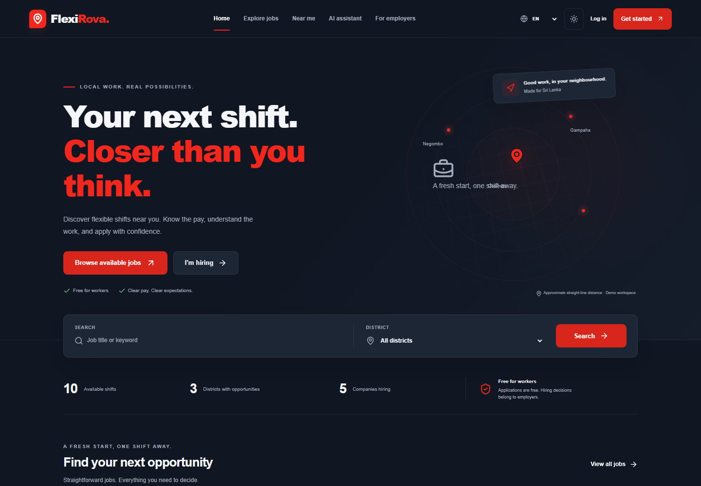
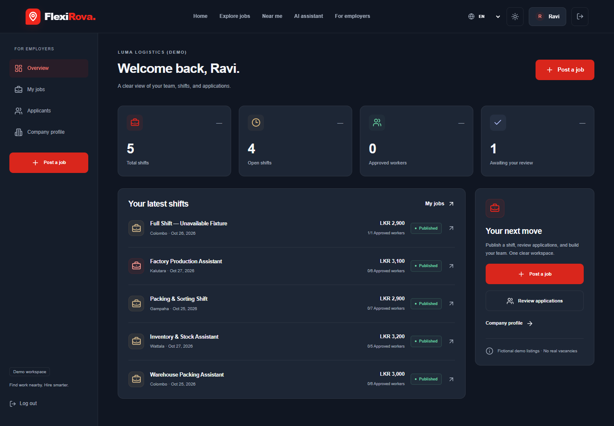
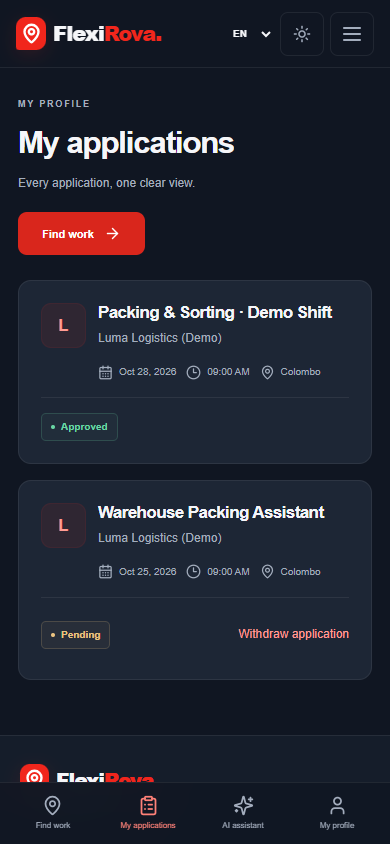

# FlexiRova

**Find work nearby. Hire smarter.**

A newly authored temporary-work marketplace for Sri Lanka. Workers can discover nearby shifts, compare disclosed wages and conditions, apply, and track decisions. Employers can publish shifts and approve applicants without exceeding capacity. Workers are not charged to browse or apply.

The user confirmed that the hackathon had started before project-specific code was written. No FlexiWork repository or project-specific source was copied. The supplied screenshots informed the red/navy/slate visual direction.

## Run locally on Windows

Requirements: Node.js 24 LTS (or a Next.js-compatible supported release), npm, Docker Desktop running Linux containers, and Chrome for browser tests.

```powershell
git clone https://github.com/MAY-Vimansa/ZeroSyntax_Hackathon.git
cd ZeroSyntax_Hackathon
npm.cmd install
npm.cmd run setup:local
npm.cmd run dev
```

Open **http://127.0.0.1:3000**. Stop the app with **Ctrl+C**. Stop this project's database containers with `npm.cmd run db:stop`; other projects are unaffected. Data is preserved by Supabase's normal stop workflow.

The one-time setup starts an isolated `flexirova` Supabase stack, applies migrations, writes generated credentials to ignored `.env.local` without printing them, and seeds fictional demo records. The first run downloads container images. No AI runtime or AI API key is required.

| Service                        | URL                    |
| ------------------------------ | ---------------------- |
| App                            | http://127.0.0.1:3000  |
| Supabase API                   | http://127.0.0.1:55321 |
| Supabase Studio                | http://127.0.0.1:55323 |
| Local verification email inbox | http://127.0.0.1:55324 |

The app binds to loopback. Supabase CLI containers currently publish their development ports on host interfaces; keep this demo on a trusted machine/network. Never expose the demo stack, credentials, or demo accounts as a production service.

### Fictional demo accounts

| Role     | Email                      | Password       |
| -------- | -------------------------- | -------------- |
| Worker   | worker@flexirova.example   | FlexiRova!2026 |
| Employer | employer@flexirova.example | FlexiRova!2026 |

Demo accounts are preconfirmed. New registrations require email verification. Local emails are captured in the local inbox and **are not delivered to actual mailboxes**. Open the confirmation link in the same browser that registered so the PKCE session can be completed.

`npm.cmd run seed` refreshes the named fictional fixtures with upcoming dates. It does not represent real jobs, business partnerships, actual payment, or verified employers.

## Working product

- Dark and light themes; responsive worker/employer layouts; English, Sinhala, and Tamil navigation, forms, statuses, and error/empty states. User-created listing content remains in its original language.
- Real Supabase email/password registration, verification, sign-in, sign-out, worker profiles, editable skills, and employer company profiles.
- Database-backed search with keyword, category, district, wage, date, sort, and server-side pagination. Full, expired, and closed shifts are excluded.
- Optional, click-triggered geolocation; 5/10/25/50 km PostGIS searches; nearest sorting; manual district fallback. Distances are approximate straight-line distances. Precise location stays in React session state and is never saved to profiles or browser storage.
- Employer create/edit/draft/publish/close workflows and applicant review. A default cutoff is one hour before the shift starts. Dates and times use Asia/Colombo; database timestamps are UTC.
- Worker apply/status/withdrawal workflows. Repeated apply requests are idempotent and keep the existing status; a withdrawn application cannot be resubmitted. Only pending applications can be withdrawn before cutoff. Approval/rejection is employer-owned, with row locking to protect capacity under concurrent requests.
- User-entered transport-cost subtraction and deterministic missing-information flags. These are estimates and information checks, not wage guarantees or fraud judgments.

## AI status — deliberately deferred

**No AI is connected. No Ollama integration or runtime dependency remains.** At the user's request, cloud AI integration will be added after API credentials are available.

The assistant screen clearly states that AI is not configured and links to working ordinary job search. `/api/ai/chat` and `/api/ai/extract-skills` return `503` with `AI_NOT_CONFIGURED`; they do not invent responses or silently simulate intelligence. Skill editing is manual until extraction is connected. There is currently no model/provider, no AI inference, and no data sent to an AI vendor.

The later integration must validate structured preferences, call the existing `searchAvailableJobs` service, and use returned records for every factual listing field. UI and search-language translations do not imply trilingual AI support.

## Architecture and interfaces

- Next.js 16 App Router, React 19, strict TypeScript, Tailwind CSS 4 and custom CSS tokens, Lucide icons, React Hook Form, Zod, Sonner.
- Supabase PostgreSQL/PostGIS, Supabase Auth with `@supabase/ssr`, server-validated sessions, and RLS on every application table.
- `src/lib/search.ts` → `search_available_jobs` SQL function: one authoritative filtering/availability service.
- Route handlers expose typed `{data: ...}` successes and `{error: {code, fields?}}` failures. Profiles, companies, jobs, applications, employer review, public stats, health, and deferred AI endpoints are implemented.
- SQL migrations live in `supabase/migrations`. Approval/withdrawal functions execute with explicit actor/ownership checks. Clients cannot change roles, verification status, approval counts, or application status directly.
- Public and worker screens share responsive components; employer screens use a dedicated workspace shell. Translation strings are centralized in `src/lib/i18n.ts`.

Auth refresh runs in Next.js Proxy; every protected API independently validates the user and role. Supabase service credentials are used only by local setup/test scripts. Runtime user requests use their scoped session, not a service-role bypass. Mutation handlers enforce same-origin requests. Process-local rate limits protect application actions; multi-instance production hosting needs a shared limiter.

## Validation

```powershell
npm.cmd run lint
npm.cmd run typecheck
npm.cmd test
npm.cmd run build
# With the app and local Supabase running:
npm.cmd run test:integration
npm.cmd run test:browser
npm.cmd run test:themes
```

The build and dev scripts use Next.js's supported **Webpack** option because this Windows host reproduced a Turbopack CSS-worker startup failure. Browser tests use an isolated installed Chrome session; test accounts and shifts are fictional and created only in local Supabase. Browser location acceptance/denial uses synthetic coordinates and error fixtures, not the user's actual location.

Theme preferences are restored before the first paint and persisted in a first-party cookie, with migration from the existing localStorage preference. Theme switching works across navigation, reloads, and open tabs. Blocked localStorage and invalid saved values are handled without breaking the application. Both palettes include dedicated readable status, error, focus, input, and avatar colors. The theme suite checks public and authenticated screens with axe accessibility analysis, keyboard/mobile controls, and contrast during theme switching.

Observed results and limitations are recorded in [docs/VALIDATION.md](docs/VALIDATION.md). Test scripts must finish successfully before treating their checks as passed.

## Screenshots of the built application





Additional mobile, light-theme, Sinhala, and Tamil captures are in `docs/screenshots`.

## Roadmap and release boundary

Deferred: real AI conversations/skill extraction/match explanations, map pins, notifications, attendance QR, worker reviews and reliability, identity verification, administration, staff permissions, earnings accounting, commissions, and payment integration. Company ratings remain excluded. No future control is presented as working functionality.

This is a local hackathon demonstration, not an operated live hiring service. Source code is available in [ZeroSyntax_Hackathon](https://github.com/MAY-Vimansa/ZeroSyntax_Hackathon); no public deployment has been created. For later deployment, configure a separate Supabase project, apply the migrations, configure production email and allowed redirects, set environment variables in the hosting provider, and keep `NEXT_PUBLIC_LOCAL_DEMO` false. The local seed and tests intentionally refuse non-local Supabase URLs. Add operational monitoring, shared rate limiting, account erasure tooling, native-speaker translation review, and a production security review before a real-user pilot.

## Environment, privacy, and attribution

`.env.example` lists the variables. `NEXT_PUBLIC_SUPABASE_ANON_KEY` is the scoped public client key; `SUPABASE_SERVICE_ROLE_KEY` must remain private and is not used by the browser. Do not commit `.env.local`. Profiles collect no NIC, biometrics, gender, home address, or required photograph. Employer contact emails are explicitly public. Employers can read profiles only for applicants to their own shifts.

No inference model powers the product at present. Review translations before release. This code uses the MIT license; third-party libraries retain their own licenses. Icons are from Lucide. External map links point to OpenStreetMap with its attribution and terms; no map tiles are fetched inside the app. No stock photos or old application code were imported.

The team handles the event's OrganizerHQ submission and confirms any event-specific disclosures and final eligibility.
