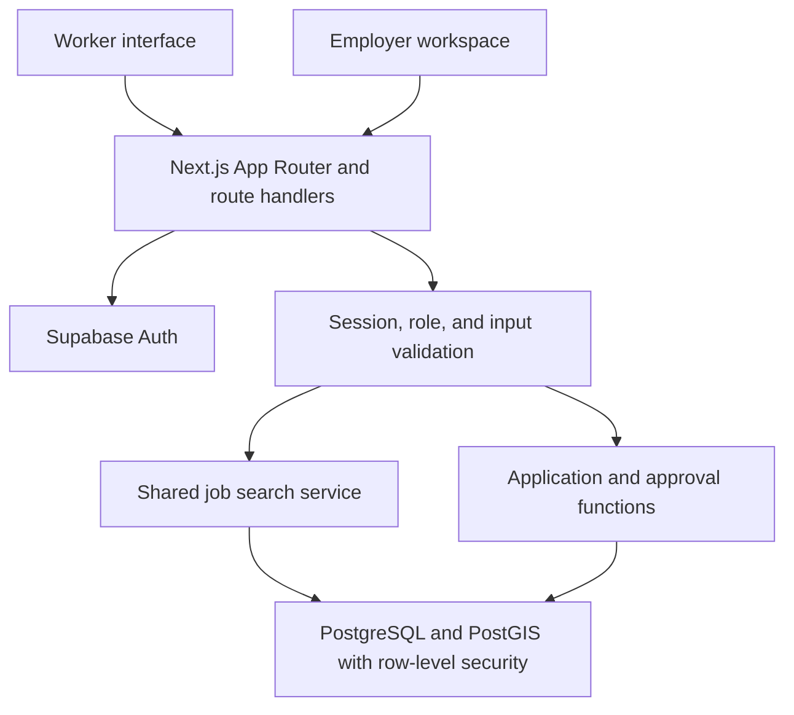

# FlexiRova

### Find work nearby. Hire smarter.

**A temporary-work marketplace built for Sri Lanka, connecting workers with nearby shifts and giving employers a clear way to manage hiring.**

[](https://nextjs.org/)
[](https://react.dev/)
[](https://www.typescriptlang.org/)
[](https://supabase.com/)
[](LICENSE)

[The problem](#the-problem) · [Features](#what-works-today) · [Quick start](#quick-start) · [Demo walkthrough](#demo-walkthrough) · [Architecture](#architecture) · [Validation](#validation)


> **Hackathon build:** a working local application with database-backed search, authentication, job publishing, applications, and employer decisions. All demo jobs, businesses, and accounts are fictional. Public hosting and AI integration are not included in this release.

## The problem

A temporary shift is only useful if a worker can understand the pay, reach the location, and know whether their application has been accepted. Employers need an equally clear way to describe a shift, review applicants, and fill the right number of places.

FlexiRova brings those decisions into one workflow:

| For workers                                               | For employers                                             |
| --------------------------------------------------------- | --------------------------------------------------------- |
| Find shifts by location, date, category, and wage.        | Publish the shift details workers need before applying.   |
| Compare disclosed pay with a personal transport estimate. | Manage drafts, published shifts, and closed listings.     |
| Apply and track the employer's decision.                  | Approve or reject applicants within the shift's capacity. |

**The goal:** make short-term work easier to discover, understand, and manage.

## What works today

### For workers

- **Search real database records:** filter by keyword, category, district, minimum daily wage, and date, with sorting and pagination.
- **Discover nearby work:** optionally share location to search within **5, 10, 25, or 50 km**, or use district filters without location access.
- **Review the details:** inspect shift times, location, required skills, daily wage in LKR, and disclosed payment terms.
- **Estimate travel impact:** subtract a transport amount you enter from the listed wage.
- **Manage applications:** apply, view pending/approved/rejected status, and withdraw eligible pending applications.
- **Maintain a profile:** edit skills, availability, location details, and a short introduction.
- **Browse and apply without worker fees.**

### For employers

- **Create a company profile** with public business contact details.
- **Publish structured shifts** with wages, times, location, skills, and required worker count.
- **Control the listing lifecycle:** create, edit, save as draft, publish, and close.
- **Review applicants** and record approval or rejection.
- **Protect shift capacity:** database transactions and row locking prevent concurrent approvals from exceeding available places.

### Across the experience

- **English, Sinhala, and Tamil** interface navigation, forms, statuses, and feedback.
- **Responsive layouts** for desktop, tablet, and phone.
- **Light and dark themes** with saved preferences.
- **Email/password authentication** and email verification through Supabase Auth.
- **Availability-aware search:** full, expired, and closed shifts are excluded.
- **Sri Lankan time handling:** shift dates and times use `Asia/Colombo`; database timestamps are stored in UTC.

User-written listing content remains in its original language. Nearby distances are approximate straight-line distances; transport calculations are user-entered estimates.

## See the application

### Employer workspace


### Worker applications


Explore [mobile](docs/screenshots/home-mobile.png), [light theme](docs/screenshots/theme-light-desktop.png), [dark theme](docs/screenshots/theme-dark-desktop.png), [Sinhala](docs/screenshots/home-si.png), and [Tamil](docs/screenshots/home-ta.png) screenshots.

These captures come from the built application using fictional demo records.

## Quick start

### Prerequisites

- **Node.js 24 LTS** and npm.
- **Git** to clone the repository.
- **Docker Desktop** running Linux containers.
- **Google Chrome** if you want to run the browser test suites.

The commands below use Windows PowerShell.

### 1. Clone and install

```powershell
git clone https://github.com/MAY-Vimansa/ZeroSyntax_Hackathon.git
cd ZeroSyntax_Hackathon
npm.cmd ci
```

### 2. Prepare the local database

Start Docker Desktop, then run:

```powershell
npm.cmd run setup:local
```

The setup script starts the isolated `flexirova` Supabase stack, applies SQL migrations, writes local settings to ignored `.env.local`, and seeds fictional accounts and shifts. The first run downloads container images.

**No AI model, AI API key, or hosted Supabase project is needed for this demo.**

### 3. Start the application

```powershell
npm.cmd run dev
```

Open **[http://127.0.0.1:3000](http://127.0.0.1:3000)**.

| Local service            | Address                                   |
| ------------------------ | ----------------------------------------- |
| Application              | [127.0.0.1:3000](http://127.0.0.1:3000)   |
| Supabase API             | [127.0.0.1:55321](http://127.0.0.1:55321) |
| Supabase Studio          | [127.0.0.1:55323](http://127.0.0.1:55323) |
| Verification email inbox | [127.0.0.1:55324](http://127.0.0.1:55324) |

Stop the application with **Ctrl+C**. Stop the project's database stack with `npm.cmd run db:stop`; Supabase preserves its local data through the normal stop workflow.

### Demo accounts

| Role     | Email                        | Password         |
| -------- | ---------------------------- | ---------------- |
| Worker   | `worker@flexirova.example`   | `FlexiRova!2026` |
| Employer | `employer@flexirova.example` | `FlexiRova!2026` |

These are fictional, preconfirmed accounts for the local demo only. Newly registered accounts require email verification. Messages appear in the **local verification inbox**, rather than being delivered to external mailboxes. Open the confirmation link in the same browser used to register.

To refresh the named demo fixtures with upcoming shift dates:

```powershell
npm.cmd run seed
```

If database startup fails, confirm Docker Desktop is running and use `npm.cmd run db:start` for diagnostic output. If the application reports missing configuration, rerun `npm.cmd run setup:local`.

## Demo walkthrough

Use separate browser profiles or an incognito window to keep worker and employer sessions independent.

1. **Discover a shift.** Open the homepage and browse jobs. Filter by district, wage, or date; optionally try nearby search.
2. **Inspect the offer.** Open a listing and review its wage, hours, location, and payment terms. Enter a transport estimate.
3. **Apply as a worker.** Sign in with the worker demo account, apply to an available shift, and open **My Applications** to see its pending status.
4. **Review as an employer.** In a separate session, sign in with the employer account and open the applicants for that shift.
5. **Make the decision.** Approve the application, then return to the worker session and refresh to see the updated status.
6. **Show the experience.** Switch language and theme, then resize to a mobile viewport.

Choose a shift owned by the demo employer for the full approval walkthrough. The employer can also create and publish a fresh shift before the worker applies.

## Architecture

FlexiRova uses a shared search service and database-enforced hiring rules to keep the worker and employer workflows consistent.



| Layer                | Technology and responsibility                             |
| -------------------- | --------------------------------------------------------- |
| Application          | Next.js 16 App Router, React 19, strict TypeScript        |
| Interface            | Tailwind CSS 4, custom theme tokens, Lucide icons, Sonner |
| Forms and validation | React Hook Form, Zod, server-side validation              |
| Authentication       | Supabase Auth and `@supabase/ssr`                         |
| Data and geography   | PostgreSQL, PostGIS, SQL migrations, row-level security   |
| Verification         | Vitest, Playwright with Chrome, axe accessibility checks  |

Search runs through `src/lib/search.ts` and the `search_available_jobs` SQL function. Application decisions run through database functions with explicit actor and ownership checks. Auth session refresh runs in Next.js Proxy; protected API handlers independently validate the user and role.

### Repository structure

```text
src/
  app/                    Pages, API routes, auth callback, and styles
  components/             Public, worker, employer, and theme interfaces
  lib/                    Search, validation, translations, and Supabase clients
  proxy.ts                Auth session refresh
supabase/
  migrations/             Schema, policies, and database functions
  config.toml             Isolated local Supabase configuration
scripts/                  Setup, seeding, integration, and browser checks
tests/                    Unit tests
docs/
  screenshots/            Captures from the built application
  PRODUCT.md              Product decisions
  IMPLEMENTATION.md       Implementation checklist
  VALIDATION.md           Recorded verification and limitations
```

## Privacy and application integrity

- **Location is optional.** Precise worker coordinates stay in the current React session state and are not saved to profiles or browser storage.
- **Profiles avoid sensitive identity fields.** No NIC, biometrics, gender, home address, or required photograph is collected.
- **Access follows ownership.** Row-level security applies to application tables; employers can read worker profiles only for applicants to their own shifts.
- **Credentials stay local.** `.env.local` is ignored by Git. The service-role key is used by local setup/test scripts and is not used in browser requests.
- **Hiring decisions stay consistent.** Repeated apply requests preserve the existing application status. Withdrawn applications cannot be resubmitted; only eligible pending applications can be withdrawn before cutoff.
- **Mutations are checked.** API handlers validate inputs, enforce role/ownership rules, check request origins, and apply process-local rate limits.

Employer contact email addresses are explicitly public. The local Supabase containers can expose development ports on host interfaces, so run the demo on a trusted machine/network.

## Validation

The [validation record](docs/VALIDATION.md) documents the following completed local checks. These results describe the tested fictional demo environment, not a production deployment.

| Check                                | Recorded result | Coverage                                                                             |
| ------------------------------------ | --------------- | ------------------------------------------------------------------------------------ |
| ESLint, TypeScript, production build | Passed          | Static checks and Webpack build                                                      |
| Unit tests                           | 12 passed       | Geography, dates, calculations, validation, translations, theme preferences          |
| API/database checks                  | 19 passed       | Search, authentication/roles, ownership, application lifecycle, concurrent approvals |
| Browser checks                       | 16 passed       | Responsive layouts, languages, location states, publishing, applying, approval       |
| Theme scenarios                      | 12 passed       | Persistence, keyboard/mobile controls, contrast, checked accessibility states        |
| Browser asset inspection             | Passed          | Server-only Supabase credential absent from browser assets                           |

### Run the checks

```powershell
npm.cmd run lint
npm.cmd run typecheck
npm.cmd test
npm.cmd run build
```

For production-mode browser verification, stop the development server and start the built application:

```powershell
npm.cmd run start
```

With that application and local Supabase running, use a second terminal:

```powershell
npm.cmd run test:integration
npm.cmd run test:browser
npm.cmd run test:themes
```

The integration and browser checks create fictional local test data. The browser suites use an installed Chrome session and synthetic geolocation fixtures. Development and production builds use the supported Webpack option because of a reproduced Turbopack CSS-worker startup issue on the original Windows host.

## Current scope and roadmap

| Working in this release                                     | Planned / deferred                                           |
| ----------------------------------------------------------- | ------------------------------------------------------------ |
| Search, nearby discovery, profiles, and company management  | AI conversations, skill extraction, and match explanations   |
| Shift publishing, applications, and capacity-safe approvals | Notifications and map pins                                   |
| Trilingual interface and light/dark themes                  | QR attendance, worker reviews, and reliability history       |
| Local email verification and fictional demo setup           | Identity verification, administration, and staff permissions |
| Wage display and transport subtraction                      | Payments, commissions, and earnings accounting               |

**AI status:** no inference model or provider is connected. The assistant screen explains this state and links to ordinary job search. `/api/ai/chat` and `/api/ai/extract-skills` return HTTP `503` with `AI_NOT_CONFIGURED`. Skill editing is manual.

Missing-information flags are deterministic checks. They do not verify employers, detect fraud, or guarantee wages. Company ratings are outside the current scope.

### Before a real-user pilot

Public hosting has not been configured. A pilot needs a separate Supabase project, production email and redirect settings, hosting environment variables, and `NEXT_PUBLIC_LOCAL_DEMO=false`. Local seed/test scripts intentionally reject remote Supabase targets.

Remaining work includes shared rate limiting for multi-instance hosting, operational monitoring, account erasure tooling, native-speaker translation review, and a production security review. External email delivery, actual hiring, payments, and AI inference have not been validated.

## Project documentation

- [Product decisions](docs/PRODUCT.md)
- [Implementation checklist](docs/IMPLEMENTATION.md)
- [Validation record and limitations](docs/VALIDATION.md)
- [Environment variable template](.env.example)
- [Application screenshots](docs/screenshots)

## License and credits

Released under the [MIT License](LICENSE). Third-party libraries retain their own licenses. Icons are provided by Lucide. External map links use OpenStreetMap; the application does not fetch map tiles.

Built for the [ZeroSyntax_Hackathon project](https://github.com/MAY-Vimansa/ZeroSyntax_Hackathon).

---

**Find a shift. Understand the offer. Track the decision.**
